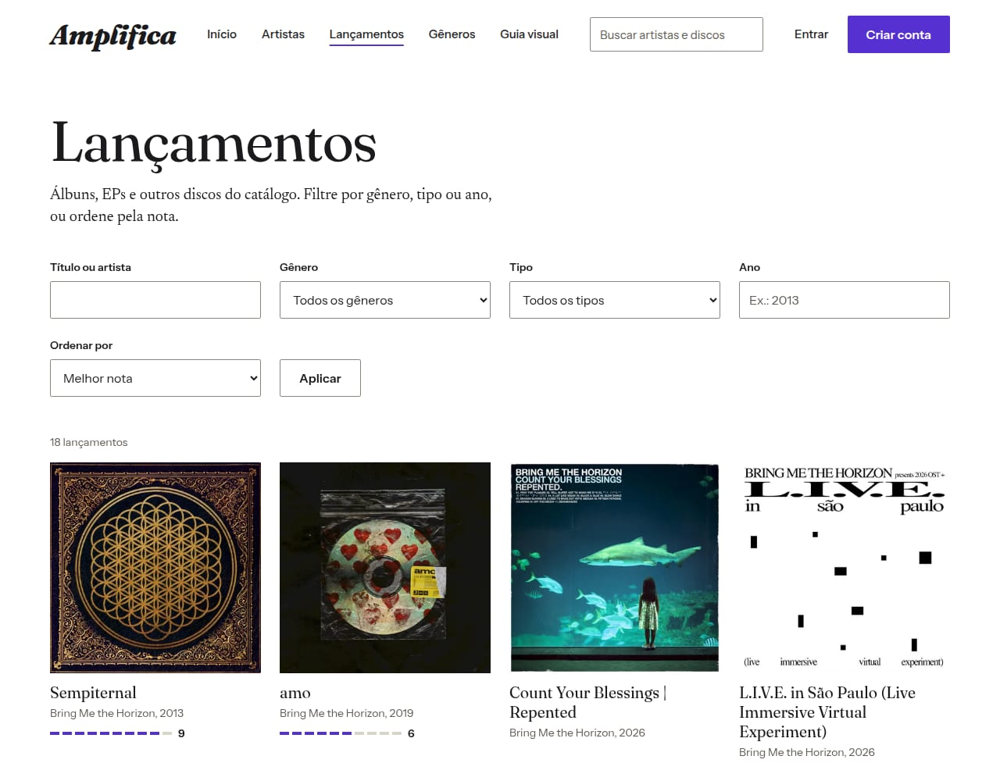
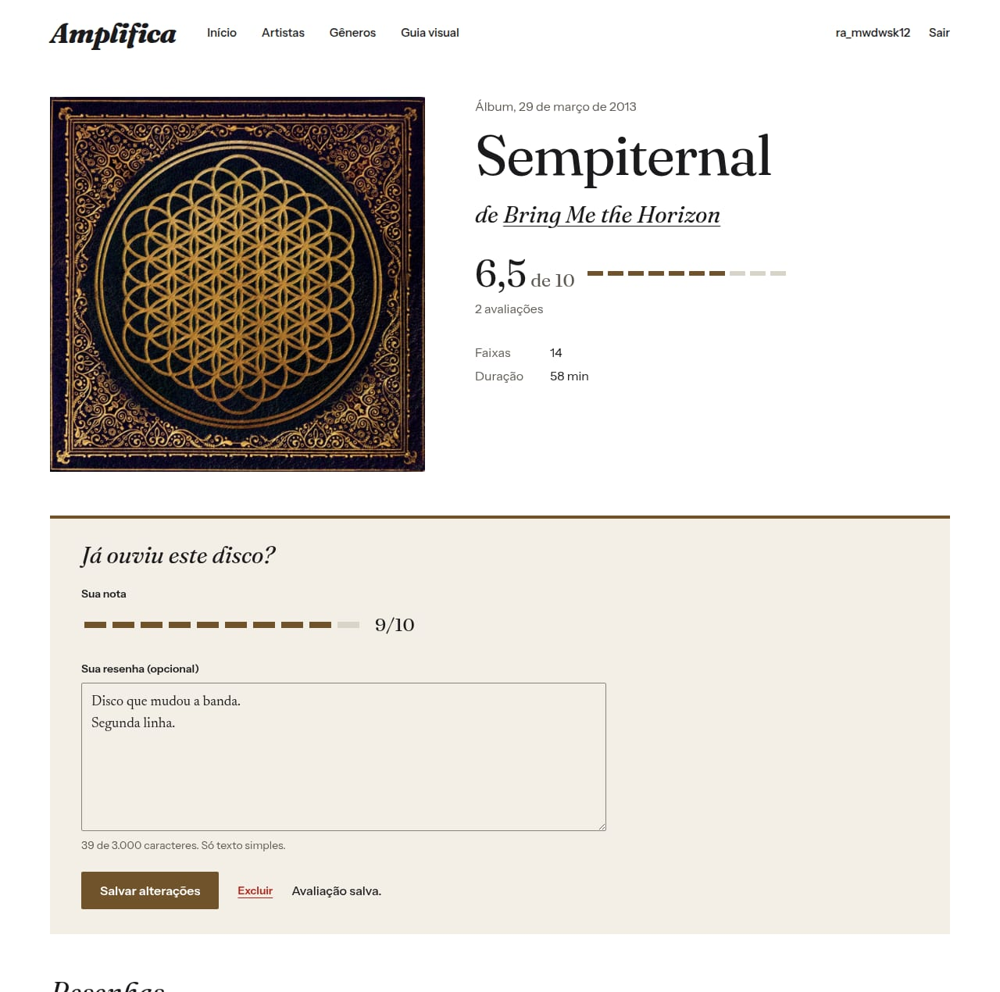
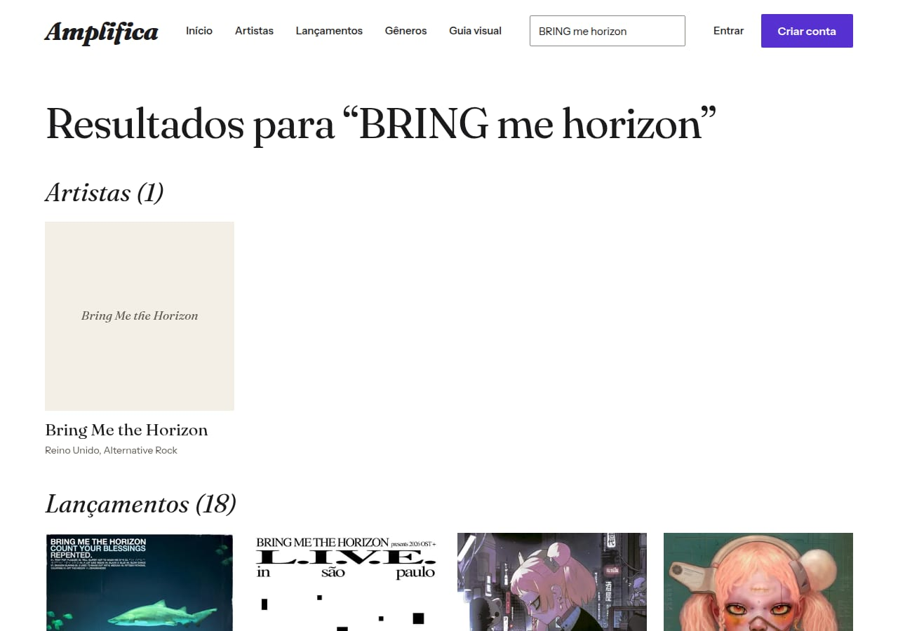
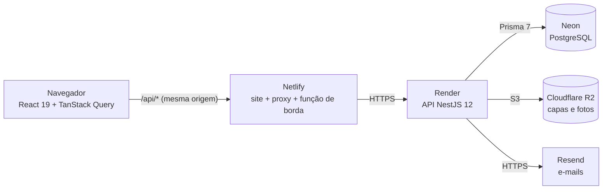

# Amplifica

[](https://github.com/Vgsalatiel/Amplifica/actions/workflows/ci.yml)

Plataforma de descoberta musical e comunidade voltada ao rock e suas vertentes: discografias organizadas, gêneros como mapa de navegação, notas e resenhas com assinatura.

**No ar:** [amplificacore.netlify.app](https://amplificacore.netlify.app) (a API gratuita hiberna: a primeira visita pode levar até 1 minuto, e o site avisa).



| | |
| --- | --- |
|  |  |

## O que o projeto faz

- **Catálogo aberto a qualquer visitante:** artistas, discografias agrupadas por tipo, faixas, gêneros em árvore (um gênero inclui os subgêneros) e a cor da capa aplicada à página de cada disco.
- **Avaliações:** nota de 1 a 10 e resenha opcional, uma por pessoa e por disco, com média no disco, nos cartões das listas e as avaliações de cada pessoa no perfil. Administradores moderam.
- **Descoberta:** busca sem acento e sem diferença de maiúsculas, filtros por gênero, tipo e ano na URL, e ordem por nota.
- **Contas:** cadastro em 3 passos, sessão com token de acesso em memória e renovação em cookie `HttpOnly`, confirmação de e-mail (exigida para avaliar quando há como enviar o link) e recuperação de senha.
- **Administração em `/admin`:** gêneros, artistas e lançamentos, com upload de imagens e extração da cor de destaque da capa.
- **Cuidados de produto:** aviso quando a API está acordando, nova tentativa automática, prévia de links (Open Graph) via função de borda da Netlify.

## Como foi feito



O navegador só fala com o domínio do site: a Netlify encaminha `/api/*` para a API, o que evita CORS e mantém o cookie de sessão na mesma origem. O raciocínio por trás de cada escolha está nas [decisões de arquitetura](#decisões-de-arquitetura).

## Stack

| Camada | Tecnologias |
| --- | --- |
| Frontend | React 19, TypeScript, Vite, Tailwind CSS, React Router, TanStack Query |
| Backend | Node.js 24, NestJS 12, TypeScript, API REST |
| Banco | PostgreSQL (Neon) com Prisma ORM 7 |
| Testes | Vitest, Testing Library, Supertest |

## Estrutura

```text
.
├── backend/    # API NestJS
├── frontend/   # SPA React
└── docs/adr/   # decisões de arquitetura
```

## Como rodar

Pré-requisitos: Node.js 24 (`nvm use` lê o `.nvmrc`) e um banco PostgreSQL no [Neon](https://neon.com).

### 1. Backend

```bash
cd backend
npm install
cp .env.example .env   # preencha as strings do Neon e gere o JWT_ACCESS_SECRET
npm run prisma:deploy  # cria as tabelas
npm run start:dev
```

A API sobe em `http://localhost:3000/api/v1`. Teste com `curl http://localhost:3000/api/v1/health`.

### 2. Frontend

Em outro terminal:

```bash
cd frontend
npm install
npm run dev
```

Abra o endereço que o Vite mostrar. Se a API estiver em outra porta que não a 3000, use `API_PROXY_TARGET=http://localhost:3100 npm run dev`. A página `/guia` reúne os componentes e mostra se a API e o banco estão no ar.

## Páginas públicas

| Rota | O que mostra |
| --- | --- |
| `/` | Lançamentos recentes e os gêneros principais |
| `/artistas` | Lista com filtro por gênero e busca pelo nome |
| `/artistas/:slug` | História, gêneros e discografia agrupada por tipo |
| `/lancamentos` | Todos os discos, com busca, gênero, tipo, ano e ordem (nota, mais recentes, título); os filtros ficam na URL |
| `/buscar?q=` | Resultado da caixa de busca do cabeçalho: artistas e lançamentos, cada um paginado |
| `/lancamentos/:slug` | Capa, média das notas, faixas, vídeo, resenhas e o formulário de avaliação (para quem tem conta); a cor da capa vale para a página toda |
| `/generos`, `/generos/:slug` | A árvore de gêneros; um gênero com os artistas dele e dos subgêneros |
| `/u/:username` | Perfil público, com os discos que a pessoa avaliou |
| `/entrar`, `/cadastro`, `/esqueci-a-senha`, `/redefinir-senha`, `/confirmar-email` | Conta e recuperação de acesso |

Tudo isso abre sem conta. Quem quer avaliar cria uma, e o cadastro iniciado a partir de um disco volta a ele.

## Dados do catálogo

Os discos entram por um arquivo de dados que você revisa antes de ir para o banco:

```bash
cd backend
# 1. Busca a discografia no MusicBrainz e escreve um arquivo para revisão
npm run catalog:fetch -- --mbid <id do artista no MusicBrainz> --genres deathcore,metalcore
# 2. Depois de revisar o arquivo, grava no banco, com as capas
npm run catalog:seed -- prisma/data/<artista>.json --covers
```

O arquivo do Bring Me The Horizon já está em `backend/prisma/data/`, com os lançamentos que uma segunda fonte não confirmou em `pending`. A carga pode ser repetida sem duplicar nada e, por padrão, não sobrescreve o que o admin editou (use `--update` para o arquivo mandar). O MusicBrainz pede que quem consulta se identifique: defina `MUSICBRAINZ_USER_AGENT` no formato `Nome/versão ( contato )`. Detalhes em [`docs/adr/0006-paginas-publicas-e-carga-de-dados.md`](docs/adr/0006-paginas-publicas-e-carga-de-dados.md).

## Administração

O catálogo é cadastrado pelo administrador em `/admin` (o link aparece no cabeçalho só para quem tem o papel ADMIN). Não existe rota que promova contas; o primeiro administrador é criado fora da interface:

```bash
# Em desenvolvimento: cria a conta, ou promove se o e-mail já existe
cd backend && ADMIN_EMAIL=voce@exemplo.com ADMIN_USERNAME=voce ADMIN_PASSWORD=uma-senha-boa npm run seed:admin
```

Em produção, promova uma conta já cadastrada no editor SQL do banco: `UPDATE "User" SET role = 'ADMIN' WHERE email = 'voce@exemplo.com';`

Os e-mails de confirmação e de nova senha saem pelo [Resend](https://resend.com) quando `RESEND_API_KEY` e `MAIL_FROM` estão definidos. Em desenvolvimento, sem elas, o link aparece no terminal da API. Em produção, sem elas, a confirmação de e-mail não é exigida e "esqueci a senha" fica indisponível ([ADR 0009](docs/adr/0009-confirmacao-de-email-e-senha.md)).

Imagens enviadas em desenvolvimento ficam em `backend/storage` (ignorada pelo Git). Em produção, o envio só funciona depois de configurar o bucket (variáveis `STORAGE_*`).

## Testes

| Camada | O que cobre | Como rodar |
| --- | --- | --- |
| Backend, unitários | Validação, mapeadores, regras puras (150+ testes) | `cd backend && npm test` |
| Backend, integração | A API inteira contra um PostgreSQL real: permissões, concorrência, buscas, e-mails (130+ testes) | `cd backend && npm run test:e2e` |
| Frontend | Telas e componentes com Testing Library, a API simulada (250+ testes) | `cd frontend && npm test` |
| Fluxos no navegador | Um Chrome real percorre o site como uma pessoa, contra a API e o banco de verdade | `cd e2e && node run.mjs` |

Os testes de fluxo (`e2e/`) sobem a API e o site em portas próprias (3100 e 5191), criam os próprios dados (contas `@e2e.amplifica.test` e itens `e2e-...`, apagados no começo e no fim) e cobrem cadastro, confirmação de e-mail, avaliações, moderação, busca, filtros, ordem por nota, recuperação de senha e o cabeçalho em várias larguras. Gravam um relatório e capturas de tela em `e2e/out/`. Precisam do Node 24, do Chrome ou Chromium (ou `CHROME_BIN`) e do mesmo `backend/.env` do desenvolvimento; nunca enviam e-mails nem gravam no bucket. Opções: `--skip-build` e `--only=reviews,discovery,email`. O CI roda tudo isso (lint, tipos, unitários, integração e fluxos) a cada push.

## Scripts

Os mesmos nos dois projetos, salvo indicação:

| Comando | O que faz |
| --- | --- |
| `npm run lint` | Análise estática com oxlint |
| `npm run typecheck` | Checagem de tipos |
| `npm test` | Testes unitários |
| `npm run test:e2e` | Testes da API contra o banco do `.env` (só no backend). Criam e apagam apenas contas `@e2e.amplifica.test` |
| `npm run build` | Build de produção |
| `npm run prisma:migrate` | Cria e aplica migrations em desenvolvimento (só no backend) |
| `npm run catalog:fetch`, `npm run catalog:seed` | Busca e carrega a discografia de um artista a partir de um arquivo revisável (só no backend) |
| `npm run seed:genres` | Cria a árvore inicial de gêneros; pode rodar de novo sem duplicar (só no backend) |
| `npm run seed:admin` | Cria o primeiro administrador a partir de `ADMIN_EMAIL`, `ADMIN_USERNAME` e `ADMIN_PASSWORD` (só no backend) |

## API

Todas as rotas ficam sob `/api/v1`. Erros seguem um formato único: `{ statusCode, code, message, details? }`.

| Rota | Acesso | O que faz |
| --- | --- | --- |
| `POST /auth/register` | Pública | Cria a conta e inicia a sessão |
| `POST /auth/login` | Pública | Inicia a sessão |
| `POST /auth/refresh` | Cookie | Renova a sessão e troca o token de renovação |
| `POST /auth/logout` | Cookie | Encerra a sessão do dispositivo |
| `GET /auth/me` | Autenticada | Dados da própria conta (`needsEmailVerification` diz se falta confirmar o e-mail) |
| `POST /auth/verify-email` | Pública | Confirma o e-mail com o token do link recebido |
| `POST /auth/resend-verification` | Autenticada | Reenvia o link de confirmação (invalida o anterior) |
| `POST /auth/forgot-password` | Pública | Pede o link de nova senha. A resposta é a mesma exista a conta ou não |
| `POST /auth/reset-password` | Pública | Define a nova senha com o token do link e encerra todas as sessões da conta |
| `GET /users/:username` | Pública | Perfil público |
| `PATCH /users/me` | Autenticada | Edita nome de exibição e bio |
| `GET /releases/:slug/reviews` | Pública | Resenhas com texto do disco, paginadas, da mais recente para a mais antiga |
| `GET`, `PUT`, `DELETE /releases/:slug/reviews/me` | Autenticada | Ver, criar ou substituir (nota de 1 a 10, resenha opcional) e apagar a própria avaliação |
| `DELETE /reviews/:id` | Autor ou ADMIN | Apaga uma avaliação (moderação) |
| `GET /users/:username/reviews` | Pública | Todas as avaliações de uma pessoa, com o disco de cada uma |
| `GET /genres`, `GET /genres/:slug` | Pública | Árvore de gêneros; um gênero com pai e filhos |
| `GET /artists` | Pública | Lista paginada. Filtros: `genre` (inclui subgêneros), `q` (nome, sem acento; cada palavra precisa aparecer) |
| `GET /artists/:slug` | Pública | Artista com discografia, do lançamento mais recente ao mais antigo |
| `GET /releases` | Pública | Lista paginada, com `rating` (média e contagem) em cada item. Filtros: `type`, `artist`, `genre` (inclui subgêneros), `year`, `q` (título ou artista, sem acento). Ordem: `sort=recent` (padrão), `rating` (sem nota por último) ou `title` |
| `GET /releases/:slug` | Pública | Lançamento com faixas, cor de destaque e vídeo |
| `POST`, `PATCH`, `DELETE` em `/genres`, `/artists`, `/releases` | ADMIN | Cadastro e edição do catálogo |
| `PUT`, `DELETE` em `/artists/:id/image` e `/releases/:id/cover` | ADMIN | Foto do artista e capa do lançamento |
| `PUT`, `DELETE /users/me/avatar` | Autenticada | Avatar da própria conta |
| `GET /health` | Pública | Estado da API e do banco |

## Deploy

| Parte | Serviço | Configuração |
| --- | --- | --- |
| API | Render (`https://amplifica.onrender.com`) | Root `backend`, build `npm install --include=dev && npm run build`, start `npm run start:prod`, que aplica as migrations antes de subir |
| Frontend | Netlify | Configurado pelo `netlify.toml`, que também encaminha `/api/*` para a API |
| Banco | Neon | Um banco para desenvolvimento e outro para produção |

As variáveis de produção ficam no painel de cada serviço, nunca no repositório. No plano gratuito, a API hiberna após um período sem acessos e a primeira requisição seguinte pode demorar.

## Decisões de arquitetura

Cada decisão relevante tem uma página própria, com contexto, alternativas e limites conhecidos:

| ADR | Assunto |
| --- | --- |
| [0001](docs/adr/0001-arquitetura-base.md) | Arquitetura base: estrutura do repositório, stack e ambientes |
| [0002](docs/adr/0002-identidade-visual.md) | Identidade visual "Editorial" e tokens de tema |
| [0003](docs/adr/0003-autenticacao.md) | Autenticação e sessão: token de acesso em memória, renovação em cookie `HttpOnly`, scrypt |
| [0004](docs/adr/0004-catalogo-e-imagens.md) | Modelo do catálogo, permissões e imagens |
| [0005](docs/adr/0005-administracao.md) | Área administrativa |
| [0006](docs/adr/0006-paginas-publicas-e-carga-de-dados.md) | Páginas públicas, cor por disco e carga de dados revisável |
| [0007](docs/adr/0007-avaliacoes.md) | Notas, resenhas e média calculada na leitura |
| [0008](docs/adr/0008-descoberta.md) | Busca sem acento, filtros e ordem por nota |
| [0009](docs/adr/0009-confirmacao-de-email-e-senha.md) | Confirmação de e-mail e recuperação de senha |

## Limites conhecidos

- A API gratuita hiberna; o site avisa e tenta de novo sozinho, mas a primeira visita demora.
- A ordem por nota é calculada em memória sobre o resultado filtrado: serve para centenas ou poucos milhares de discos (ADR 0008).
- A busca não corrige erros de digitação e não existe busca por usuários.
- As capas vêm do Cover Art Archive e pertencem aos respectivos titulares; o rodapé do site explica como pedir a remoção.
- A fonte do logotipo é provisória: a escolhida tem licença apenas de demonstração (ADR 0002).
